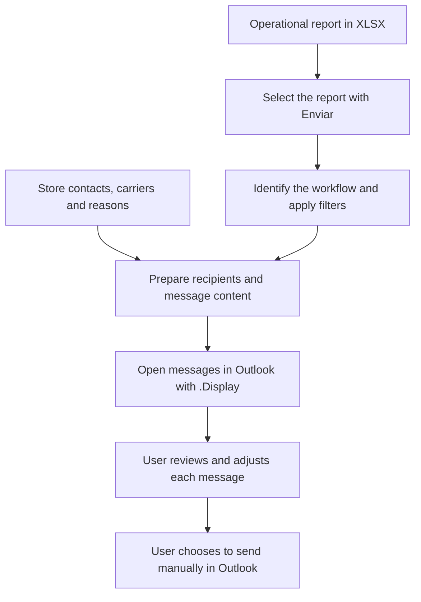
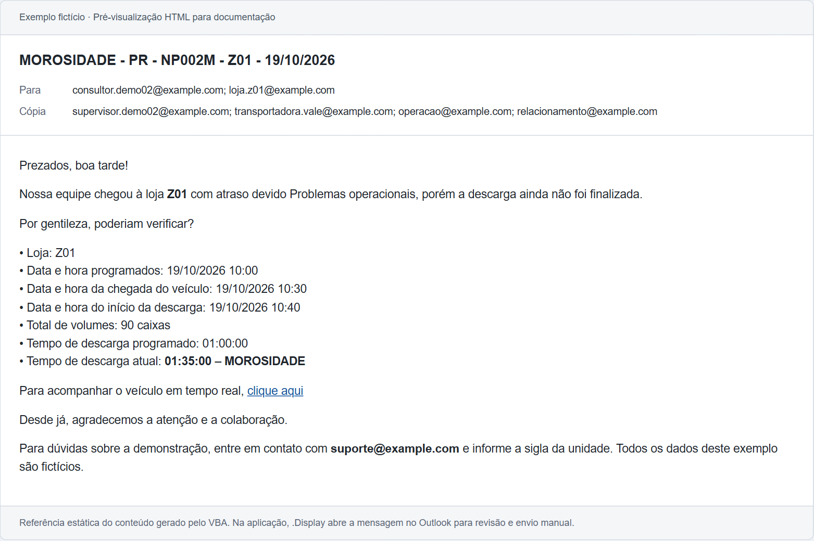

# Logistics Email Preparation with Excel and VBA

[Português (Brasil)](README.pt-BR.md)

An Excel/VBA tool developed for a Brazilian logistics operation. It reads operational reports, applies rules for unloading delays, delivery forecasts and mobile/RCS usage, looks up the relevant contacts, and prepares the messages in Outlook.

**The macro uses `.Display`, not `.Send`.** The user reviews the recipients, copied contacts, times and message content before deciding to send manually in Outlook. This review is an intentional part of the workflow.

This portfolio package demonstrates three workflows with fictional data. The application and source code remain in Brazilian Portuguese; this README provides an English guide. The executable is [Comunicados_Logisticos.xlsm](app/Comunicados_Logisticos.xlsm), adapted from the original application version **2.4.5**.

## The operational problem

Preparing operational notices involves interpreting different reports, selecting the applicable records, finding store and carrier contacts, and assembling the details of each case. Repeating these steps manually can produce inconsistent recipients, times and message content.

The application automates message preparation while keeping the final operational check with the user. Despite the Excel button being labelled **Enviar** (Send), it opens editable messages in Outlook; it does not send them automatically.

## Workflow

## What the project demonstrates

- Importing different operational report layouts and applying workflow-specific filters.
- Looking up recipients and copied contacts across Excel reference workbooks.
- Building HTML messages with delivery times, unloading details, contact numbers and tracking links.
- Grouping mobile/RCS notices by route to avoid duplicate messages within the imported report.
- Separating scheduled delivery time from actual arrival time.
- Using relative paths so that the package can be moved without rewriting network paths.

## Fictional example

In the late-arrival unloading example, store **Z01** has an updated delivery time of **10:30** and a delay of **00:30**. Its scheduled time is therefore **10:00**. Actual arrival is read separately from `CH ENTREG`, which is **10:30** in this case.

This image is a static HTML rendering for documentation, not an Outlook screenshot. The six messages were also opened and checked separately in classic Outlook. The reference previews omit the user's Outlook signature; appearance and any configured signature can differ in the desktop application.

The [reference examples](examples/expected-output/README.md) include all six messages, their recipients and their HTML bodies. They are static references and cannot send email.

## Language and sample data

The interface, code, comments, worksheet names and report headers remain in Brazilian Portuguese. Dates follow the Brazilian convention: `19/10/2026` means **19 October 2026**. These are fixed sample dates, not a live operational feed.

The package contains **six stores (Z00–Z05), six restaurant records, twelve phone records and three CD/route-prefix mappings**. People, contact details, carriers, vehicle plates and example tracking links were replaced with fictional values. Emails use `example.com`; phone numbers are demonstrative placeholders.

Original technical identifiers and report labels remain where they are needed to explain or preserve the application. The supporting filename `BD_McD.xlsx` and some legacy routine names have been retained. No real tracking destinations, contact list, mailbox profile or signature is included in the reference examples.

## Requirements

- Microsoft Excel desktop for Windows, with VBA macros enabled for this project.
- **Classic Outlook desktop for Windows**, with a configured mail profile, for the demonstrated COM integration.
- A locally extracted or locally synchronised copy, preserving the `app/` structure and supporting filenames.

The demonstration was validated in a Portuguese-language Windows/Excel environment with classic Outlook. New Outlook, Outlook on the web, Excel on the web, macOS and other regional configurations have not been validated.

GitHub presents and distributes the project; it does not run the VBA or provide a mail service.

## Run the demonstration

1. Download or clone the repository and extract it to a local folder.
2. Open [the application](app/Comunicados_Logisticos.xlsm) in Excel desktop. Keep `BD_McD.xlsx`, `CD e NOMENCLATURAS.xlsm` and the `arquivos/` folder together inside `app/`.
3. In the `Export` worksheet, click **Enviar** and select one of the sample XLSX reports in `app/arquivos/`.
4. Wait for the messages to open in Outlook. Each supplied report should prepare **two messages**.
5. Review the recipients, copied contacts, times, reasons and tracking links. Adjust the message as needed. Sending remains a **manual decision in Outlook**; the sample addresses are fictional.

The VBA identifies the workflow from the report's filename. Keep the sample filenames and headers unchanged. Choose one report per run.

The demonstrated path reads its inputs without saving changes to them. The source report's communication flags are not updated by opening the messages, and the original persistent sending log is inactive. Running the same report again can therefore open the same messages again. Close sample messages without saving or sending when finished; use the supplied files for a repeatable demonstration.

## Validated examples

| Report | Data rows | Messages opened | Other cases demonstrated |
| --- | ---: | ---: | --- |
| `LOJAS COM MOROSIDADE NA DESCARGA.xlsx` | 4 | 2 | Already communicated; unloading duration of exactly 10 minutes |
| `ATRASO FUTURO.xlsx` | 5 | 2 | Already communicated; zero delay; missing reason marked `-` |
| `TABELA GERAL.xlsx` | 7 | 2 | Repeated route; RCS already used; already communicated; loading stages |

The six messages were checked in an isolated VBA message-construction run and then opened in classic Outlook. The Outlook checks covered subjects, recipients, copied contacts and the corrected delivery times. The test windows were closed without saving, and **no email was sent**.

A regression test changed Z01's actual arrival to **12:15** while keeping its scheduled time at **10:00**. Relative-path checks also exercised the three imports after moving the application to a folder containing spaces and accented characters.

See the [validation record](docs/VALIDACAO.md) for the test scope and the [public-content review](docs/REVISAO_CONTEUDO_PUBLICO.md) for the package checks.

## Repository guide

| Folder | Purpose |
| --- | --- |
| `app/` | Executable XLSM, reference workbooks and fictional input reports |
| `examples/expected-output/` | Six static HTML messages and a structured JSON reference |
| `src/vba/` | Six extracted VBA module/class files for reading on GitHub |
| `docs/` | Package map, validation, content review and static preview images |

Start with the [VBA guide](src/vba/LEIA-ME.md). The main entry points are `BtnEnviarTudo`, `CarregarArquivo` and `EnviarEmailsOutlook` in [Módulo1.bas](<src/vba/principal/Módulo1.bas>). Path resolution and fictional shared contacts are centralised in [modPortfolio.bas](src/vba/principal/modPortfolio.bas).

## Scope and validation limits

- The supplied demonstration covers unloading-delay notices, future delivery-delay forecasts and mobile/RCS usage notices. The loader also recognises `ATRASO ATUAL`, but no separate sample of that report was validated.
- Additional routines for updating start-of-unloading records and preparing return-to-CD WhatsApp messages remain in the source. They require other inputs and were not exercised in this demonstration; the optional `programacoes/` folder is not supplied.
- The VBA supports review and manual sending. There is no automatic sending, delivery confirmation or active persistent sending log in the demonstrated path.
- Static HTML previews reproduce the generated content with documentation styling. They do not reproduce every Outlook rendering detail or a configured personal signature.

The application is provided as a portfolio demonstration using fictional operational examples. No measured time savings, delivery results or production-scale performance claims are made.

## Related project

[Logistics Scheduling with Excel and VBA](https://github.com/nickolas-dev/excel-vba-logistics-scheduling) demonstrates the schedule-preparation and export workflow from the first portfolio project.
