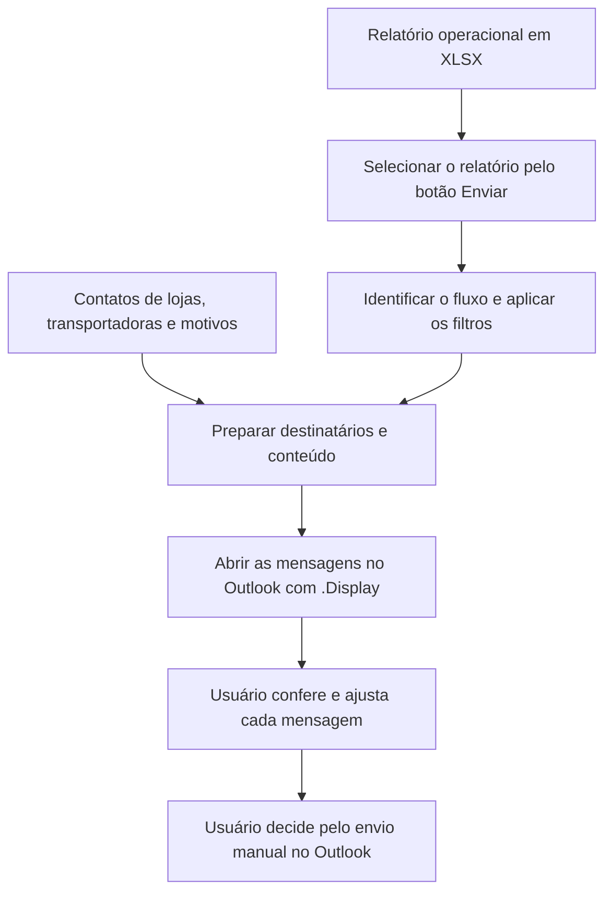

# Preparação de Comunicados Logísticos com Excel e VBA

[English (UK)](README.md)

Ferramenta em Excel/VBA desenvolvida para uma operação logística brasileira. Ela lê relatórios operacionais, aplica regras para morosidade na descarga, previsão de entrega e uso do mobile/RCS, consulta os contatos necessários e prepara as mensagens no Outlook.

**A macro usa `.Display`, e não `.Send`.** O usuário confere destinatários, cópias, horários e conteúdo antes de decidir pelo envio manual no Outlook. Essa revisão é uma etapa intencional do fluxo.

Este pacote de portfólio demonstra três fluxos com dados fictícios. Aplicação e código permanecem em português brasileiro; o README em inglês apresenta o projeto para outros públicos. O executável é [Comunicados_Logisticos.xlsm](app/Comunicados_Logisticos.xlsm), adaptado da versão original **2.4.5**.

## O problema da operação

Preparar comunicados operacionais envolve interpretar relatórios diferentes, selecionar os registros aplicáveis, localizar os contatos de lojas e transportadoras e montar os detalhes de cada caso. Repetir essas etapas manualmente pode gerar divergências nos destinatários, horários e textos.

A ferramenta automatiza a preparação das mensagens, mantendo a conferência operacional com o usuário. Embora o botão no Excel se chame **Enviar**, ele abre mensagens editáveis no Outlook; não realiza o envio automático.

## Fluxo

## O que o projeto demonstra

- Importação de layouts diferentes de relatórios e aplicação dos filtros de cada fluxo.
- Consulta de destinatários e contatos em cópia em arquivos auxiliares do Excel.
- Montagem de e-mails HTML com horários, detalhes da descarga, telefones e links de rastreamento.
- Agrupamento dos avisos de mobile/RCS por rota, evitando mensagens duplicadas no relatório importado.
- Separação entre o horário de entrega programado e a chegada real do veículo.
- Uso de caminhos relativos, permitindo mover o pacote sem reescrever caminhos de rede.

## Exemplo fictício

No exemplo de morosidade com chegada em atraso, a loja **Z01** tem previsão atualizada de **10:30** e atraso de **00:30**. O horário programado é, portanto, **10:00**. A chegada real vem separadamente de `CH ENTREG`, que neste caso é **10:30**.

A imagem é uma renderização HTML estática para documentação, e não uma captura do Outlook. As seis mensagens também foram abertas e conferidas separadamente no Outlook clássico. As referências não incluem a assinatura do usuário; a aparência e uma assinatura configurada podem variar na aplicação desktop.

Os [exemplos de referência](examples/expected-output/README.md) contêm as seis mensagens, seus destinatários e os corpos HTML. São referências estáticas e não enviam e-mails.

## Idioma e dados do exemplo

Interface, código, comentários, nomes das planilhas e cabeçalhos dos relatórios permanecem em português brasileiro. As datas seguem a convenção brasileira: `19/10/2026` significa **19 de outubro de 2026**. São datas fixas dos exemplos, sem consulta a uma operação ao vivo.

O pacote contém **seis lojas (Z00–Z05), seis registros de restaurantes, doze registros de telefones e três combinações de CD/nomenclatura**. Pessoas, contatos, transportadoras, placas e links de rastreamento dos exemplos foram substituídos por valores fictícios. Os e-mails usam `example.com`; os telefones são preenchimentos demonstrativos.

Identificadores técnicos e rótulos originais dos relatórios foram mantidos quando necessários para explicar ou preservar a aplicação. O nome auxiliar `BD_McD.xlsx` e alguns nomes de rotinas antigas continuam no projeto. Os exemplos de referência não incluem destinos reais de rastreamento, lista real de contatos, perfil de e-mail ou assinatura.

## Requisitos

- Microsoft Excel desktop para Windows, com execução de macros VBA habilitada para o projeto.
- **Outlook clássico desktop para Windows**, com perfil de e-mail configurado, para a integração COM demonstrada.
- Uma cópia extraída localmente ou sincronizada para uso local, mantendo a estrutura de `app/` e os nomes dos auxiliares.

A demonstração foi validada em um ambiente Windows/Excel em português com Outlook clássico. Novo Outlook, Outlook na web, Excel na web, macOS e outras configurações regionais não foram validados.

O GitHub apresenta e distribui o projeto; ele não executa o VBA nem fornece um serviço de e-mail.

## Executar a demonstração

1. Baixe ou clone o repositório e extraia os arquivos em uma pasta local.
2. Abra [a aplicação](app/Comunicados_Logisticos.xlsm) no Excel desktop. Mantenha `BD_McD.xlsx`, `CD e NOMENCLATURAS.xlsm` e a pasta `arquivos/` juntos dentro de `app/`.
3. Na planilha `Export`, clique em **Enviar** e selecione um dos relatórios XLSX em `app/arquivos/`.
4. Aguarde a abertura das mensagens no Outlook. Cada relatório fornecido deve preparar **duas mensagens**.
5. Confira destinatários, cópias, horários, motivos e links de rastreamento. Ajuste o que for necessário. O envio continua sendo uma **decisão manual no Outlook**; os endereços dos exemplos são fictícios.

O VBA identifica o fluxo pelo nome do relatório. Preserve os nomes dos arquivos de exemplo e seus cabeçalhos. Selecione um relatório por execução.

O fluxo demonstrado lê as entradas sem salvar alterações nelas. A abertura das mensagens não atualiza as marcações de comunicação do relatório, e o log persistente de envio original está inativo. Portanto, repetir o mesmo relatório pode abrir novamente as mesmas mensagens. Ao terminar o teste, feche os exemplos sem salvar nem enviar; os arquivos fornecidos permitem repetir a demonstração.

## Exemplos validados

| Relatório | Linhas de dados | Mensagens abertas | Outros casos demonstrados |
| --- | ---: | ---: | --- |
| `LOJAS COM MOROSIDADE NA DESCARGA.xlsx` | 4 | 2 | Comunicação já marcada; tempo de descarga de exatamente 10 minutos |
| `ATRASO FUTURO.xlsx` | 5 | 2 | Comunicação já marcada; atraso zerado; motivo ausente indicado por `-` |
| `TABELA GERAL.xlsx` | 7 | 2 | Rota repetida; RCS já utilizado; comunicação já marcada; etapas de carregamento |

As seis mensagens foram conferidas em uma execução isolada da montagem pelo VBA e depois abertas no Outlook clássico. A conferência no Outlook cobriu assuntos, destinatários, cópias e os horários corrigidos. As janelas de teste foram fechadas sem salvar, e **nenhum e-mail foi enviado**.

Um teste de regressão alterou a chegada real da Z01 para **12:15**, mantendo o programado às **10:00**. A validação dos caminhos relativos também exercitou as três importações após mover a aplicação para uma pasta com espaços e caracteres acentuados.

Consulte o [registro de validação](docs/VALIDACAO.md) para o escopo dos testes e a [revisão do conteúdo público](docs/REVISAO_CONTEUDO_PUBLICO.md) para as conferências do pacote.

## Organização do repositório

| Pasta | Finalidade |
| --- | --- |
| `app/` | XLSM executável, arquivos auxiliares e relatórios fictícios de entrada |
| `examples/expected-output/` | Seis mensagens HTML estáticas e uma referência estruturada em JSON |
| `src/vba/` | Seis arquivos de módulos/classes VBA para leitura no GitHub |
| `docs/` | Mapa do pacote, validação, revisão do conteúdo e imagens estáticas |

Para ler o código, comece pelo [guia do VBA](src/vba/LEIA-ME.md). As entradas principais são `BtnEnviarTudo`, `CarregarArquivo` e `EnviarEmailsOutlook`, em [Módulo1.bas](<src/vba/principal/Módulo1.bas>). A resolução de caminhos e os contatos fictícios compartilhados estão centralizados em [modPortfolio.bas](src/vba/principal/modPortfolio.bas).

## Escopo e limites da validação

- A demonstração fornecida cobre morosidade na descarga, previsão de atraso futuro e avisos de uso do mobile/RCS. A importação também reconhece `ATRASO ATUAL`, mas não foi validado um exemplo separado desse relatório.
- As rotinas adicionais de atualização do início da descarga e preparação de mensagens de retorno ao CD por WhatsApp permanecem nos fontes. Elas exigem outras entradas e não foram exercitadas nesta demonstração; a pasta opcional `programacoes/` não é fornecida.
- O VBA apoia a revisão e o envio manual. O fluxo demonstrado não tem envio automático, confirmação de entrega nem log persistente de envio ativo.
- As prévias HTML reproduzem o conteúdo gerado com uma apresentação própria da documentação. Não reproduzem todos os detalhes visuais do Outlook nem uma assinatura pessoal configurada.

A aplicação é apresentada como demonstração de portfólio com exemplos operacionais fictícios. Não são feitas afirmações de economia de tempo medida, resultados de entrega ou desempenho em escala de produção.

## Projeto relacionado

[Programação Logística com Excel e VBA](https://github.com/nickolas-dev/excel-vba-logistics-scheduling) demonstra o fluxo de preparação de programações e exportação do primeiro projeto de portfólio.
