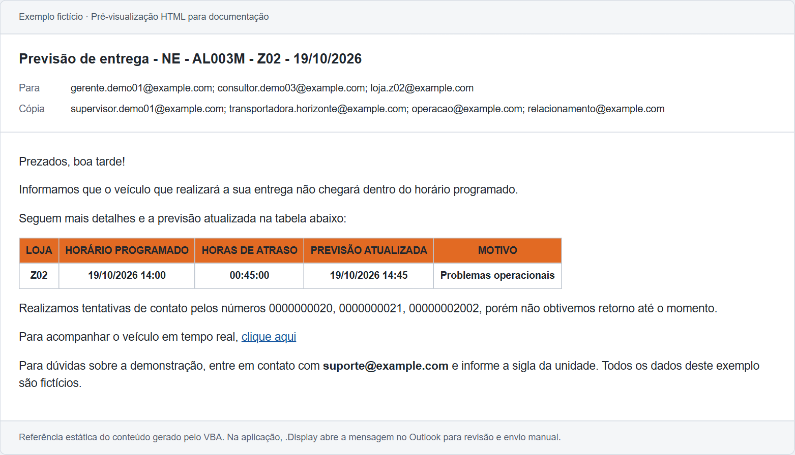
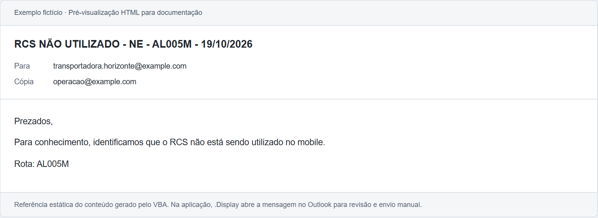

# Exemplos de comunicados

Referências estáticas dos **seis comunicados** montados pelo VBA com os relatórios fictícios fornecidos. O conteúdo foi capturado na validação isolada da montagem das mensagens. Uma execução separada também abriu os seis comunicados no Outlook clássico; nenhum foi enviado.

Os arquivos HTML acrescentam um cabeçalho de documentação com assunto, destinatários e cópias. O corpo gerado pelo VBA permanece em português. Não há perfil de e-mail, assinatura pessoal ou conexão com uma caixa postal nesses arquivos. A aparência foi preparada para leitura no navegador e pode variar em relação ao Outlook.

| Fluxo | Caso | Referência HTML |
| --- | --- | --- |
| Morosidade | Z00: chegada dentro do horário; descarga ainda não finalizada | [morosidade-z00.html](morosidade-z00.html) |
| Morosidade | Z01: programado às 10:00; chegada real às 10:30 | [morosidade-z01.html](morosidade-z01.html) |
| Atraso futuro | Z02: programado às 14:00; previsão atualizada para 14:45 | [atraso-z02.html](atraso-z02.html) |
| Atraso futuro | Z03: programado às 14:00; previsão atualizada para 15:00 | [atraso-z03.html](atraso-z03.html) |
| Mobile/RCS | Uma mensagem para a rota AL005M | [mobile-al005m.html](mobile-al005m.html) |
| Mobile/RCS | Uma mensagem para a rota NP006M | [mobile-np006m.html](mobile-np006m.html) |

No GitHub, os HTMLs podem ser exibidos como código. Para ver a página formatada, baixe o pacote e abra o arquivo no navegador. As imagens abaixo permitem consultar três exemplos diretamente no GitHub.

O arquivo [comunicados.json](comunicados.json) reúne assuntos, destinatários, cópias e corpos HTML sem a apresentação adicional da página. As saudações são as da execução de referência; na aplicação, variam conforme o horário da execução.

## Morosidade com atraso

## Previsão de entrega

## Mobile/RCS

Essas referências não executam o VBA nem enviam mensagens. Para reproduzir o fluxo, use a aplicação e os relatórios de `app/`. A macro abre os e-mails com `.Display` para conferência; o envio é manual no Outlook.
